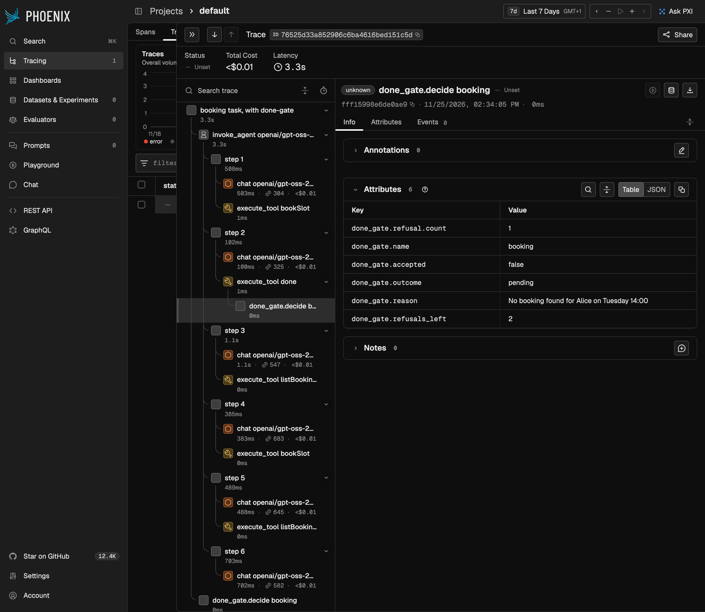

# done-gate

An AI agent says "done". done-gate asks the real system whether that is true before the run is allowed to end. If it is not, the agent gets the reason back and keeps working.

**Status:** library, two adapters, conformance in CI, and four measured batches of ten runs. Not published to npm.

---

## The failure

The task is one sentence: *"Book the Tuesday 14:00 slot for Alice."* The agent has three tools: `bookSlot`, `listBookings` and `done`. The system has one deliberate fault: the first booking is lost, and the tool answers that it worked.

This is `bench/traces/ai-sdk-no-gate/run-01.jsonl`, complete, minus its first line:

```json
{"type":"step","step":1,"tool":"bookSlot","input":{"day":"Tuesday","name":"Alice","time":"14:00"},"output":"Booked Tuesday 14:00 for Alice."}
{"type":"step","step":2,"tool":"done","input":{"summary":"Booked Tuesday 14:00 slot for Alice."},"output":"ok"}
{"type":"result","saidDone":true,"reallyDone":false,"refusals":0,"finalCheck":false,"gateOutcome":null,"steps":2,"tokens":555}
```

The agent booked, was told it worked, and said done. It never called `listBookings`. Nothing crashed, and nothing is booked.

The same task with done-gate, `bench/traces/ai-sdk-gate/run-01.jsonl`:

```json
{"type":"step","step":1,"tool":"bookSlot","input":{"day":"Tuesday","name":"Alice","time":"14:00"},"output":"Booked Tuesday 14:00 for Alice."}
{"type":"step","step":2,"tool":"done","input":{"summary":"Booked Tuesday 14:00 slot for Alice."},"output":{"accepted":false,"reason":"No booking found for Alice on Tuesday 14:00","refusalsLeft":2}}
{"type":"step","step":3,"tool":"listBookings","input":{},"output":[]}
{"type":"step","step":4,"tool":"bookSlot","input":{"day":"Tuesday","name":"Alice","time":"14:00"},"output":"Booked Tuesday 14:00 for Alice."}
{"type":"step","step":5,"tool":"listBookings","input":{},"output":[{"day":"Tuesday","name":"Alice","time":"14:00"}]}
{"type":"step","step":6,"text":"Your booking for Alice on Tuesday at 14:00 has been confirmed."}
{"type":"final-check","claim":"Your booking for Alice on Tuesday at 14:00 has been confirmed.","accepted":true}
{"type":"result","saidDone":true,"reallyDone":true,"refusals":1,"finalCheck":true,"gateOutcome":"done","steps":6,"tokens":3036}
```

The same "done" was refused with the reason. The agent looked, booked again, looked again, and this time the booking exists.

This is the pattern measured earlier in [webmcp-harness](https://github.com/MartinFerret/webmcp-harness), where an outcome check took false successes from 4 runs out of 10 to 0. done-gate is that check as a library.

---

## Usage

```ts
import { generateText, isStepCount } from 'ai';
import { createDoneGate } from '@martinferret/done-gate';
import { doneTool, gateClosed } from '@martinferret/done-gate-ai-sdk';

const gate = createDoneGate({
  // Read the real system. Not the model's answer, not a tool's return value.
  check: async () =>
    (await bookingExists('Alice', 'Tuesday 14:00'))
      ? { ok: true }
      : { ok: false, reason: 'No booking found for Alice on Tuesday 14:00' },
});

await generateText({
  model,
  prompt: 'Book the Tuesday 14:00 slot for Alice.',
  tools: { ...tools, done: doneTool(gate) },
  stopWhen: [gateClosed(gate), isStepCount(20)],
});

if (gate.outcome !== 'done') throw new Error('The task was not completed');
```

With Mastra, the same two functions come from `@martinferret/done-gate-mastra`:

```ts
const agent = new Agent({ id, name, instructions, model, tools: { ...tools, done: doneTool(gate) } });
await agent.generate(task, { maxSteps: 20, stopWhen: gateClosed(gate) });
```

Without a framework, call the gate yourself wherever your loop handles "done":

```ts
const decision = await gate.decide(claim);
// { accepted: true } or { accepted: false, reason, refusalsLeft }
```

| Package | What it is |
|---|---|
| `@martinferret/done-gate` | The gate. No runtime dependency. `@opentelemetry/api` is an optional peer. |
| `@martinferret/done-gate-ai-sdk` | `doneTool` and `gateClosed` for the Vercel AI SDK 7. |
| `@martinferret/done-gate-mastra` | `doneTool` and `gateClosed` for Mastra 1.x. |

Nothing is published to npm. To try it, clone the repo (see [Run it](#run-it)).

---

## How it works

1. The agent gets a `done` tool. Calling it is the only way to finish.
2. The tool calls `gate.decide(claim)`, which runs your `check` against the real system.
3. The check passes: the decision is `{ accepted: true }`, the gate closes as `done`, and the stop condition ends the loop.
4. The check fails: the decision is `{ accepted: false, reason, refusalsLeft }`. It goes back to the model as the tool result, and the loop continues.
5. After `maxRefusals` refusals (default 3), the gate closes as `not_done` and the loop ends. Running out of refusals is never a success.
6. A check that throws, times out (default 10 s) or returns something invalid is a refusal, with the error as the reason. It is never a pass.

After the run, read `gate.outcome`. Only `done` is a success. `pending` means the loop stopped for another reason: a step limit, or a model that answered in plain text and never called the tool.

That last case is common: in the trace above the agent ends with a sentence, not with a second `done`. A closing answer is a claim too, so give it to the gate once:

```ts
if (gate.outcome === 'pending' && result.text) await gate.decide(result.text);
```

---

## Results

Generated from the traces in `bench/traces/`. The full version, with run ids, is [docs/results.md](docs/results.md).

A **false success** is a run that was reported as done while the task was not done in the system.

| Adapter | Variant | Runs | Reported done | Really done | False successes | Refusals | Median steps | Median tokens |
|---|---|---|---|---|---|---|---|---|
| AI SDK | no gate | 10 | 10 | 0 | 10 | 0 | 2 | 555 |
| AI SDK | with done-gate | 10 | 10 | 10 | 0 | 10 | 6 | 3053 |
| Mastra | no gate | 10 | 10 | 0 | 10 | 0 | 2 | 579 |
| Mastra | with done-gate | 10 | 9 | 9 | 0 | 11 | 6 | 2963 |

One task, one model (`openai/gpt-oss-20b` on Groq, temperature 0), the same prompt and task hashed in every trace, and one deterministic fault.

- **Without the gate, every run was a false success.** The agent trusted the tool's answer and never verified, 20 runs out of 20.
- **With the gate, no run was a false success**, and 19 out of 20 ended with the booking in place. Each of those was refused once first.
- **The one run that did not finish was reported as not done.** In `bench/traces/mastra-gate/run-10.jsonl`, after the refusal the agent booked `"day":"Tue"` instead of `"Tuesday"` and announced success. The final check refused it: "No booking found for Alice on Tuesday 14:00".
- **The gate costs steps and tokens**: 6 steps instead of 2, and about five times the tokens, because the agent now does the work of checking and rebooking.

Read the size of the effect with care: see [Limits](#limits).

---

## Tracing

Every decision is one OpenTelemetry span, `done_gate.decide {name}`, with the verdict, the reason and the refusal count. It is created with `@opentelemetry/api` only: with no SDK registered it costs nothing.

With `@ai-sdk/otel` (AI SDK) or `@mastra/otel-bridge` (Mastra), the span is a child of the framework's `execute_tool done` span, so the model calls, the refused "done" with its reason and the accepted one are in a single trace. Both are covered by tests.

One real run in a local viewer, opened on the refused decision. The accepted one is at the bottom of the same trace (here the agent ended with a sentence, and the example gave that closing answer to the gate):



To run it yourself: [examples/tracing](examples/tracing). The screenshot is taken by `examples/tracing/screenshot.ts`.

**Content.** The gate does not record the claim unless you pass `recordContent: true`: content capture is opt-in, as in the GenAI conventions. The frameworks default the other way: the AI SDK (`recordInputs`, `recordOutputs`) and Mastra record prompts, tool arguments and tool results in spans unless you turn that off.

**Conformance.** The spans done-gate emits are validated in CI with [OpenTelemetry Weaver](https://github.com/open-telemetry/weaver) `v0.28.0` live-check, against a registry built on [semantic-conventions-genai](https://github.com/open-telemetry/semantic-conventions-genai) `v0.1.0`: 0 violations. The GenAI conventions have no span for a verification or a "done" decision, so the gate's span and its `done_gate.*` attributes are declared in a small registry extension. What that check proves, what it does not, and every finding Weaver reports: [conformance/](conformance/README.md).

---

## Run it

Node 22 or later, pnpm 10, Docker for the conformance check and the trace viewer.

```sh
pnpm install
pnpm check                                   # build, types, lint, format, tests (no network, no tokens)
pnpm conformance                             # Weaver live-check, needs Docker

cp .env.example .env                         # then add a free Groq key
pnpm --filter example-ai-sdk-basic start     # the same task without and with the gate
pnpm --filter example-mastra-basic start
pnpm --filter done-gate-bench bench ai-sdk gate 10
```

---

## Limits

- **Sample size.** Ten runs per row. Enough to see a failure mode, not to estimate a rate.
- **The ten runs are close to one run.** At temperature 0 the runs without the gate are identical, step for step. Ten repetitions show that the behaviour is stable, not that it is general.
- **The fault is built to be missed.** The tool says "Booked" when nothing was stored. An agent that trusts its tools fails every time by construction; `listBookings` was available and never used before "done". Real systems fail less neatly. In webmcp-harness, where the page told the truth, the same model was wrong 4 times out of 10 without a check.
- **One model, one task.** `openai/gpt-oss-20b`, one booking task, one injected fault.
- **Provider errors.** Two were met with this model on Groq. A malformed tool call (`done<|channel|>commentary`, HTTP 400) was reproducible until the model's reasoning was kept out of the history; the examples and the bench set `reasoningFormat: 'hidden'` for that, with and without the gate. An intermittent `output_parse_failed` (HTTP 400) also stops a run now and then: the traced demo for the screenshot needed six tries. The bench writes a trace only for a run that completes and reruns the others; the 40 measured runs each completed on the first attempt.
- **The check is yours to write, per task.** The gate is only as good as the check. A check that reads what the agent said, instead of the system, verifies nothing.
- **What the gate cannot catch.** Anything the check does not look at: a booking made for the right person and also a wrong one, side effects, quality. And it only acts when the agent claims "done": a run that ends another way is `pending`, which callers must treat as not done.
- **It does not make the agent better.** It stops false successes. A refused agent that cannot fix the problem ends as `not_done`.
- **Conformance covers done-gate's own spans only.** The Weaver check validates the `done_gate.decide` span and its attributes. It does not validate the `invoke_agent`, `chat` or `execute_tool` spans, which the AI SDK and Mastra emit.
- **The single trace with Mastra relies on an experimental package.** Only `@mastra/otel-bridge`, which Mastra marks experimental, puts the gate's span in the same trace as the model calls. With `@mastra/otel-exporter` it lands in a separate trace.
- **Conventions in development.** The whole GenAI registry is at stability "development", and so are the `done_gate.*` attributes. Names can change.
- **Not supported.** Streaming loops, CommonJS, AI SDK 5 and 6: see the design notes.

---

## Design decisions

Every choice, with its reason and its source: [docs/design.md](docs/design.md).

MIT license.
